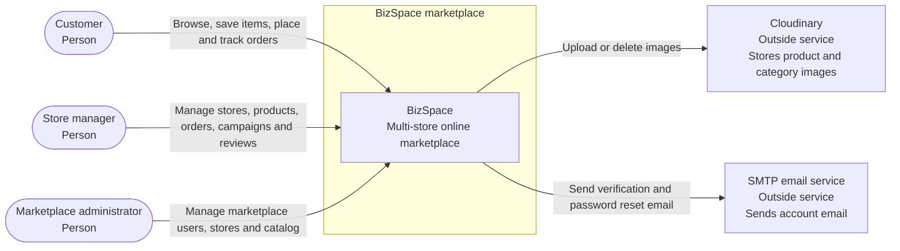
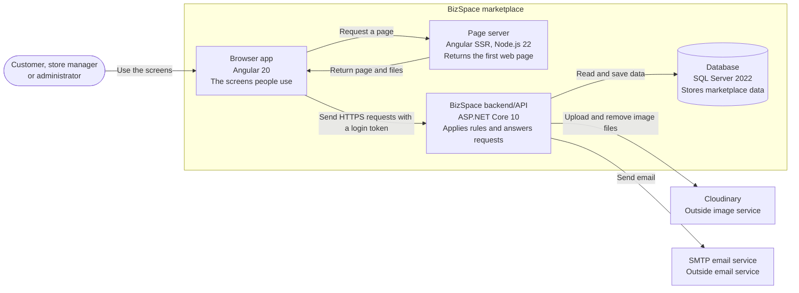
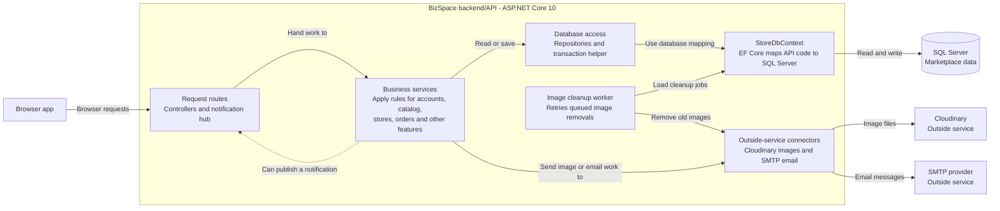
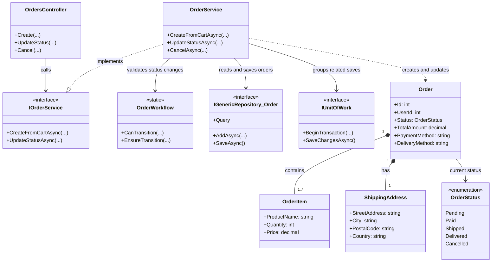

# BizSpace

BizSpace is a marketplace for independent stores. Customers can browse products, manage a wishlist and addresses, and place orders. Store managers manage products, orders, campaigns, and reviews; administrators manage the marketplace.

## Architecture: C4 model

The diagrams below show BizSpace at four levels: the people and outside services around it, the applications and database it runs, the main parts inside the API, and one example of how order code is connected. For a printable version, see the [plain-language C4 model PDF](BizSpace-C4-Model-Plain-Language.pdf).

### Level 1: System context - who uses BizSpace?



### Level 2: Containers - what runs BizSpace?

The browser app and page server are separate runtime containers built from the Angular project. Docker Compose runs the page server, API, and SQL database.



### Level 3: Components - what parts do the work inside the API?



The Angular app currently gets notifications through regular API requests. The API has a SignalR notification hub, but the Angular app does not connect to it.

### Level 4: Code - how does one order move through the code?

This is a close-up of the order feature, not a diagram of every class. The controller receives the request, the service handles order work, and `OrderWorkflow` checks whether a status change is allowed.



Checkout records a payment method, but it does not call a payment provider.

This workspace contains two projects:

```text
BizSpace/
├── README.md
├── docker-compose.yml             Full-stack Compose entry point
├── docker-compose.production.yml   Production deployment stack
├── .github/workflows/deploy.yml   Push-triggered deployment workflow
├── BizSpace/                      Angular 20 frontend
└── BizSpace.API/                  ASP.NET Core 10 API and SQL Server setup
```

## Start the full application with Docker Compose

From the workspace root in Windows CMD, run:

```cmd
docker compose up --build
```

Compose builds and starts all three services. The frontend is at <http://localhost:4200>, the API is at <http://localhost:8080>, and Swagger is at <http://localhost:8080/swagger>. On first startup, the API applies EF Core migrations and seeds the demo catalog, store managers, stores, and the admin account configured in `BizSpace.API/.env`. It does not seed customer accounts or orders.

## Backend

The backend is an ASP.NET Core API backed by SQL Server. The workspace-level Compose file starts the API, SQL Server, and Angular frontend together.

### Requirements

- Docker Desktop for the API and SQL Server containers
- .NET 10 SDK only if running the API directly on the host

### Configure the API

The API requires a local `.env` file in `BizSpace.API`. From the workspace root, run `cd BizSpace.API` and create or open the file with:

```cmd
notepad .env
```

If `.env` already exists, keep its current private values. If creating it, use this template and replace each placeholder with a value for your local setup before starting the API. `Jwt__Key` and `Auth__CodeHmacKey` must each be at least 32 bytes.

```dotenv
BIZSPACE_DB_SA_PASSWORD=DB_SA_PASSWORD
ConnectionStrings__DefaultConnection=SQL_SERVER_CONNECTION_STRING
Jwt__Key=JWT_SIGNING_KEY
Auth__CodeHmacKey=AUTH_CODE_HMAC_KEY
Jwt__Issuer=JWT_ISSUER
Jwt__Audience=JWT_AUDIENCE
Database__ApplyMigrations=true
SeedAdmin__Email=ADMIN_EMAIL
SeedAdmin__Password=ADMIN_PASSWORD
Email__Host=SMTP_HOST
Email__Port=587
Email__UserName=SMTP_USERNAME
Email__Password=SMTP_PASSWORD
Email__FromAddress=SMTP_FROM_ADDRESS
Email__FromName=BizSpace
Email__UseStartTls=true
Email__UseAuthentication=true
Cloudinary__CloudName=CLOUDINARY_CLOUD_NAME
Cloudinary__ApiKey=CLOUDINARY_API_KEY
Cloudinary__ApiSecret=CLOUDINARY_API_SECRET
```

`.env` is ignored by Git. These values are for placeholder purposes only; replace the placeholders with your own values.

### Run the API with the .NET SDK

Install the .NET 10 SDK and provide a reachable SQL Server connection string in `.env`. From the workspace root, run:

```cmd
cd BizSpace.API
dotnet restore
dotnet run --project .\BizSpace.API\BizSpace.API.csproj --launch-profile http
```

This profile listens at <http://localhost:5210>. The frontend defaults to `http://localhost:8080/api`; use Docker Compose for the no-change setup above, or set `apiBaseUrl` in `BizSpace/public/bizspace-config.js` to `http://localhost:5210/api` for this profile.

### API tests and migrations

Run API unit tests from the `BizSpace.API` folder:

```cmd
dotnet test .\BizSpace.Tests\BizSpace.Tests.csproj
```

Create and apply migrations from that same folder:

```cmd
dotnet ef migrations add DescribeYourChange --project .\BizSpace.API\BizSpace.API.csproj --startup-project .\BizSpace.API\BizSpace.API.csproj --output-dir Data\Migrations
dotnet ef database update --project .\BizSpace.API\BizSpace.API.csproj --startup-project .\BizSpace.API\BizSpace.API.csproj
```

Generate an idempotent SQL migration script for review:

```cmd
dotnet ef migrations script --idempotent --project .\BizSpace.API\BizSpace.API.csproj --startup-project .\BizSpace.API\BizSpace.API.csproj --output .\BizSpace.Migrations.sql
```

The SQL script is written to the API solution folder and is not executed automatically. API unit tests use temporary in-memory data and do not need SQL Server or Cloudinary.

## Frontend

The frontend is an Angular standalone app with lazy-loaded customer pages, responsive layouts, and shared signal-based state. Each customer route has a folder under `BizSpace/src/app/pages/`, reusable UI lives in `BizSpace/src/app/components/`, and shared API, authentication, and state logic lives in `BizSpace/src/app/services/`.

### Requirements

- Node.js `20.19+`, `22.12+`, or `24.0+` with npm ([Angular version compatibility](https://angular.dev/reference/versions))
- Angular CLI 20 for the `ng s` command

### Start from Windows CMD

Install Angular CLI once if `ng` is not already available:

```cmd
npm install --global @angular/cli@20
```

From the workspace root, open a second CMD window and run:

```cmd
cd BizSpace
npm ci
ng s
```

Open <http://localhost:4200>. Stop the development server with `Ctrl+C`.

Without a global CLI install, run `npx ng s` or `npm start` after `npm ci`.

The frontend uses `http://localhost:8080/api` by default, configured in `BizSpace/public/bizspace-config.js`. The workspace Compose file builds the Angular image from `BizSpace/Dockerfile` and includes the API services from `BizSpace.API/docker-compose.yml`. For local Angular development outside Docker, you can still use the `ng s` steps below while the backend is running.

### Build and test

Run from the `BizSpace` frontend folder:

```cmd
npm run build
npm test
```

Card checkout is a project demo flow; no payment processor is connected.

## Deploy with GitHub Actions

`.github/workflows/deploy.yml` deploys on pushes to `master` and supports manual runs. It checks out the pushed commit and runs `docker compose up -d --build` with `docker-compose.production.yml`.

Before the first deployment, configure a self-hosted Linux x64 GitHub Actions runner with the labels `self-hosted`, `linux`, and `x64`. Keep the runner service online, install Docker Engine and the Docker Compose plugin, and use Actions Runner version 2.327.1 or later for `actions/checkout@v7`.

Keep the private production `.env` on the self-hosted runner at `$HOME/BizSpace/BizSpace.API/.env`, matching the path used by the workflow. If it is elsewhere, set the GitHub repository **Actions variable** `BIZSPACE_ENV_FILE` to its absolute path. The production Compose file accepts either the Linux deployment names (`JWT_SIGNING_KEY`, `AUTH_CODE_HMAC_KEY`, `SEED_ADMIN_EMAIL`, `SEED_ADMIN_PASSWORD`, and `SMTP_*`) or the matching .NET setting names used in a local `.env` (`Jwt__Key`, `Auth__CodeHmacKey`, `SeedAdmin__Email`, `SeedAdmin__Password`, and `Email__*`). `BIZSPACE_DB_SA_PASSWORD` and the `Cloudinary__*` keys are the same in both formats. The JWT and HMAC keys must each be at least 32 bytes. Optional settings include `JWT_ISSUER` / `Jwt__Issuer` (default `BizSpace.Api`), `JWT_AUDIENCE` / `Jwt__Audience` (default `BizSpace.Client`), SMTP port (default `587`), sender name (default `BizSpace`), StartTLS (default `true`), and SMTP authentication (default `true`). The production Compose file builds the container-to-container SQL connection itself; its `ConnectionStrings__DefaultConnection` does not use the Windows/local SQL connection string in the `.env` file.

Use either the normal local `docker compose up --build` stack or the production stack on a given Docker engine at a time; they use the same ports.

The workflow determines the runner's IPv4 address for the browser and CORS settings. If that address is not reachable by users, set the Actions variable `BIZSPACE_HOST_IP` to the reachable IPv4 address or DNS name. Allow or forward ports `4200` (web app) and `8080` (API) through the VM and host firewall. The current production Compose file serves HTTP and writes an HTTP API URL into the browser bundle; public HTTPS also requires updating the reverse-proxy, API URL, and CORS origin settings.
